# CodeRoom

A real-time collaborative code editor that runs in the browser. Create a workspace, share
the link, and everyone edits the same files at the same time, with live cursors, presence,
per-user undo and one-click code execution.

**Live demo:** https://code-room-xi.vercel.app

---

## Table of contents

1. [What CodeRoom does](#1-what-coderoom-does)
2. [Tech stack](#2-tech-stack)
3. [Architecture at a glance](#3-architecture-at-a-glance)
4. [How collaboration works](#4-how-collaboration-works)
   - [4.1 The shared document](#41-the-shared-document)
   - [4.2 From one keystroke to every collaborator](#42-from-one-keystroke-to-every-collaborator)
   - [4.3 Presence, cursors and typing](#43-presence-cursors-and-typing)
   - [4.4 Undo that respects other people](#44-undo-that-respects-other-people)
   - [4.5 Going offline and reconnecting](#45-going-offline-and-reconnecting)
5. [The backend](#5-the-backend)
   - [5.1 One port for REST and WebSocket](#51-one-port-for-rest-and-websocket)
   - [5.2 Module layout](#52-module-layout)
   - [5.3 Persistence lifecycle](#53-persistence-lifecycle)
   - [5.4 REST and WebSocket API](#54-rest-and-websocket-api)
   - [5.5 Running code with Judge0](#55-running-code-with-judge0)
   - [5.6 Limits, errors and security](#56-limits-errors-and-security)
6. [The frontend](#6-the-frontend)
   - [6.1 Pages and components](#61-pages-and-components)
   - [6.2 Hooks: connecting React to Yjs](#62-hooks-connecting-react-to-yjs)
   - [6.3 The Monaco ↔ Yjs binding](#63-the-monaco--yjs-binding)
7. [Data model](#7-data-model)
8. [What happens when…](#8-what-happens-when)
9. [Design decisions and trade-offs](#9-design-decisions-and-trade-offs)
10. [Project structure](#10-project-structure)
11. [Running locally](#11-running-locally)
12. [Testing](#12-testing)
13. [Deployment](#13-deployment)
14. [Known limitations and future work](#14-known-limitations-and-future-work)
15. [FAQ](#15-faq)
16. [Glossary](#16-glossary)

---

## 1. What CodeRoom does

| Feature | What the user sees | How it works |
| --- | --- | --- |
| Workspaces | "Create Workspace" gives a short ID such as `K7QMZ2XP` and a shareable link | Express creates a row in Postgres with a starter document |
| Multi-file editing | A file list you can add to, rename and delete from | The file tree is a `Y.Map` inside the shared Yjs document |
| Live collaboration | Everyone's typing appears instantly for everyone else | Yjs CRDT updates sent over one WebSocket by Hocuspocus |
| Cursors and selections | Coloured carets and highlighted selections for each person | Yjs awareness with cursor positions stored as relative positions |
| Presence and activity | Who is here, which file they are in, who joined, left or is typing | Awareness state per browser tab |
| Per-user undo | `Ctrl/Cmd+Z` reverts only your own edits | `Y.UndoManager` that tracks only local changes |
| Connection status | A badge that says **Live**, **Reconnecting…** or **Offline** | Hocuspocus provider status events |
| Offline editing | You can keep typing when the connection drops; it syncs when it returns | Edits stay in the local Yjs document and merge on reconnect |
| Language detection | Syntax highlighting and a starter snippet chosen from the file extension | Extension → Monaco language map |
| Run code | Output, errors and run time for 11 languages | Backend forwards the active file to Judge0 CE |

---

## 2. Tech stack

| Layer | Technology | Role |
| --- | --- | --- |
| UI | React 19, TypeScript, Vite, React Router 7 | Pages, components and routing |
| Editor | Monaco Editor via `@monaco-editor/react` | The VS Code editor component, loaded from a CDN |
| Collaboration | Yjs, `@hocuspocus/provider` | CRDT document, awareness and the client side of sync |
| Server | Node.js 22, Express 5 | REST API, middleware and the HTTP server |
| Real-time server | `@hocuspocus/server`, `ws` | Yjs sync protocol, document loading and saving |
| Database | PostgreSQL, Prisma 6 | Stores each workspace's document as bytes |
| Code execution | Judge0 CE via RapidAPI | Compiles and runs submitted code in a sandbox |
| Protection | `express-rate-limit` | Per-IP limits on code runs and workspace creation |
| Quality | Vitest, Supertest, ESLint, GitHub Actions | Unit, route and live sync tests; linting; CI |
| Hosting | Vercel, Render, Supabase | Frontend, backend and database |

---

## 3. Architecture at a glance

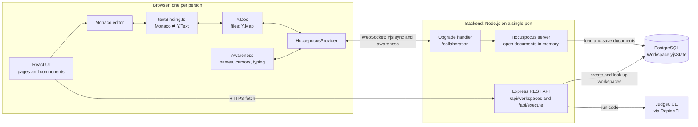

**The idea in three sentences.** Everything people share in a workspace (the file list and
every file's text) lives in one Yjs document, so concurrent changes merge automatically
without conflicts. Hocuspocus keeps that document in sync over a single WebSocket and saves
it to Postgres as bytes. Express only creates workspaces, checks that they exist and
forwards code to Judge0.

There are two ways the browser talks to the server, each with one job:

| Channel | Used for | Why this channel |
| --- | --- | --- |
| HTTPS (REST) | Create a workspace, check a workspace exists, run code | One-off request and response; easy to rate limit and validate |
| WebSocket (`/collaboration`) | Every shared change: files, text, presence | Long-lived, two-way and low latency; Yjs needs a stream of small binary updates |

---

## 4. How collaboration works

### 4.1 The shared document

Each workspace has exactly one Yjs document. Its name on the server is the workspace ID.

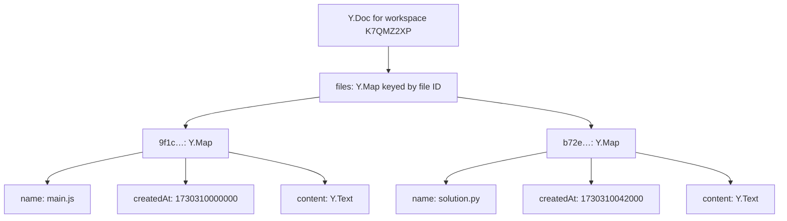

Important details:

- **Files are keyed by a generated ID, not by name.** Renaming changes only the `name`
  field, so open editors, cursors and the saved "last open file" keep pointing at the same file.
- **Files are nested inside one `files` map.** Yjs can never delete a top-level type, but
  deleting an entry from a map removes the nested `Y.Text` too, and Yjs garbage-collects its
  content. An earlier version stored each file as a top-level `Y.Text`, so deleted files
  lingered in the saved state forever.
- **`createdAt` gives a stable order.** `Y.Map` has no order, so the file list is sorted by
  `createdAt`, then by name.
- **The server writes to the document exactly once**, when the workspace is created and
  `main.js` is seeded. After that only browsers change it; the server just relays and saves.
- **A new file's starter snippet is written in the same operation that creates the file.**
  Only the person who creates the file does this, so the snippet can never be duplicated. An
  earlier version inserted the snippet when an empty file was opened, which duplicated it
  when two people opened the file together and brought it back after someone cleared the file.

File names are checked before a file is created or renamed
([workspaceDocument.ts](frontend/src/collaboration/workspaceDocument.ts)): 1–64 characters,
only letters, digits, `.`, `-` and `_`, and no duplicate names ignoring case.

### 4.2 From one keystroke to every collaborator

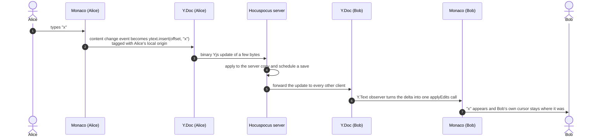

Three guards keep this loop from going wrong:

1. **No echo from editor to document.** While remote changes are being written into Monaco,
   a flag (`isApplyingRemoteChange`) makes the binding ignore Monaco's change events, so a
   remote edit is never sent back as if it were local.
2. **No echo from document to editor.** Local changes are written to Yjs with a private
   `Symbol` as the transaction origin. The `Y.Text` observer skips transactions with that
   origin, because Monaco already shows them.
3. **No cursor jumps.** Remote changes are applied with `model.applyEdits`, never
   `model.setValue`, which would reset everyone's cursor to the top of the file.

### 4.3 Presence, cursors and typing

Presence uses **Yjs awareness**: a small state object per browser tab that is shared with
everyone in the workspace but never saved.

| Field | Example | Set by | Used for |
| --- | --- | --- | --- |
| `user` | `{ name: "Alice", colorIndex: 3 }` | `WorkspacePage` when the name changes | Presence chips and colours |
| `activeFileId` | `"9f1c…"` | `WorkspacePage` when the open file changes | "Alice · main.js" in the presence list |
| `cursor` | `{ fileId, anchor, head }` | The editor whenever the selection changes | Remote carets and selections |
| `isTyping` | `true` | The editor on each local edit; resets after 1.5 s | The **Typing** panel |

**Why cursor positions are relative positions.** A plain offset such as "character 120"
goes stale as soon as someone types above it. CodeRoom stores Yjs *relative positions*,
which point at a specific character's internal ID, and converts them back to an offset when
drawing.

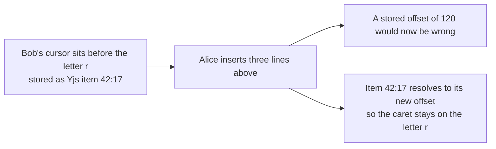

Other details:

- **Each tab is its own peer.** Awareness is keyed by the Yjs client ID, so the same person
  in two tabs appears twice and both cursors are drawn.
- **Remote state is untrusted input.** [`presence.ts`](frontend/src/collaboration/presence.ts)
  checks the shape of every field, ignores peers without a valid `user`, and clamps
  `colorIndex` to the 8-colour palette. Names are escaped before being shown in Monaco's
  hover text, and React escapes them everywhere else.
- **Peers disappear on their own.** When a client disconnects, the others remove its state.
  If a client vanishes without closing cleanly, awareness drops it after 30 seconds without a
  heartbeat.
- **Joined and left messages compare against known peers.** When a peer returns after a
  reconnect, Yjs reports it as *updated*, not *added*, because it keeps metadata for removed
  clients. The activity feed therefore treats any peer it is not already tracking as "joined",
  and it seeds that list with the people already present, so opening a workspace does not show
  a burst of "joined" messages.
- **Cursor updates are deduplicated.** When someone else's edit moves your cursor, Monaco
  fires a selection event; the editor skips sending it if the encoded position has not changed.

### 4.4 Undo that respects other people

Monaco's built-in undo stack replays edits at the offsets where they originally happened.
Once a collaborator has typed above you, those offsets are wrong and undo corrupts the file.
CodeRoom replaces it:

- Each open file gets a `Y.UndoManager` that tracks **only transactions with this tab's local
  origin**, so it never reverts a teammate's text.
- `Ctrl/Cmd+Z` is undo; `Ctrl/Cmd+Shift+Z` and `Ctrl/Cmd+Y` are redo.
- Keystrokes made within 500 ms of each other are grouped into one undo step.
- Undo history belongs to the open editor, so switching files starts a fresh history.

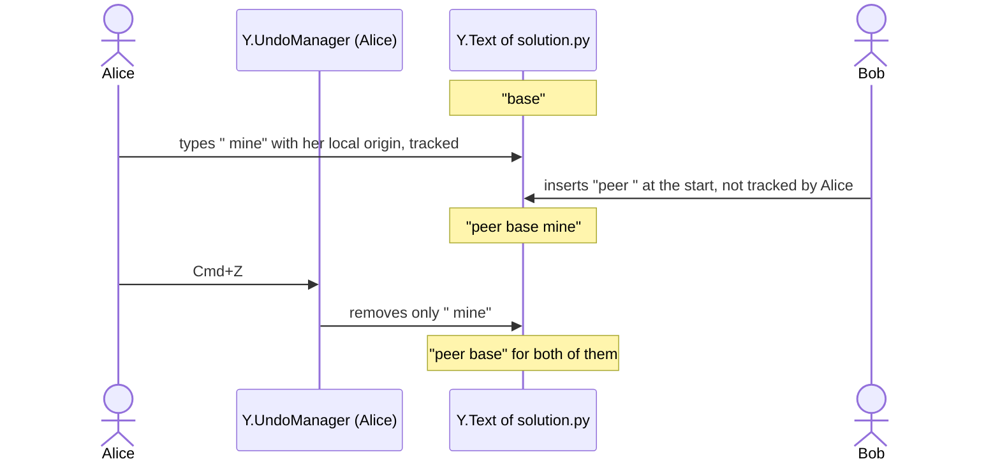

### 4.5 Going offline and reconnecting

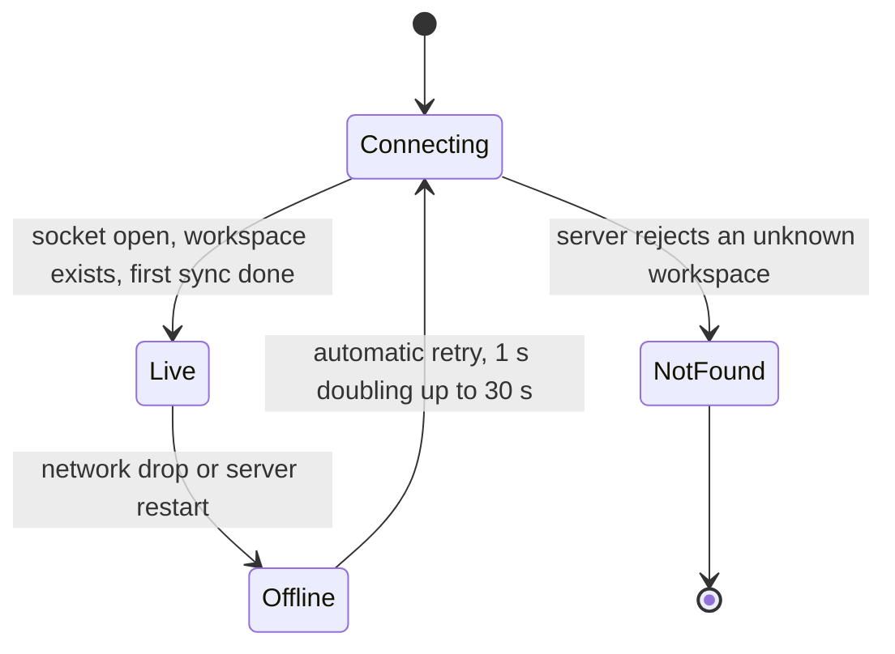

- The workspace screen is not shown until the **first** sync completes, so nobody sees an
  empty file list that fills in a moment later.
- While offline, the badge says **Offline**, editing keeps working and every change stays in
  the local `Y.Doc`.
- On reconnect, client and server exchange *state vectors* (a summary of what each has seen)
  and send each other only the missing updates. Nothing typed offline is lost, and nothing has
  to be resent in full.
- Other people's cursors disappear while you are offline and come back after reconnecting.
- If the workspace does not exist, the server refuses the connection with the reason
  `workspace-not-found`, the provider is shut down instead of retrying forever, and the page
  explains what happened.

---

## 5. The backend

### 5.1 One port for REST and WebSocket

Free hosts such as Render expose one port, so REST and WebSocket share a single Node HTTP
server ([server.js](backend/src/server.js),
[attachCollaboration.js](backend/src/collaboration/attachCollaboration.js)).

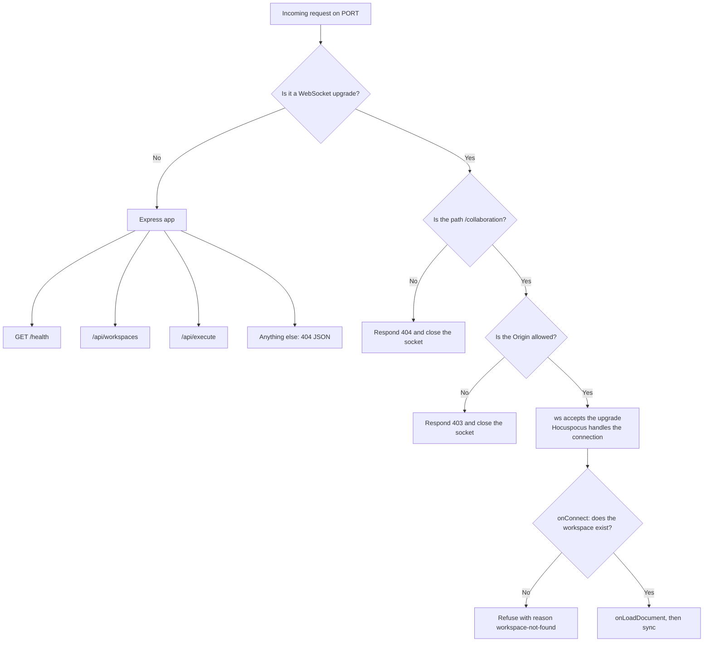

Browsers do not apply CORS to WebSockets, which is why the upgrade handler checks the
`Origin` header itself against `CLIENT_ORIGIN`.

### 5.2 Module layout

The backend is grouped by feature. Inside a feature, **routes** handle HTTP only,
**services** hold the rules, and the **repository** is the only code that talks to Prisma.

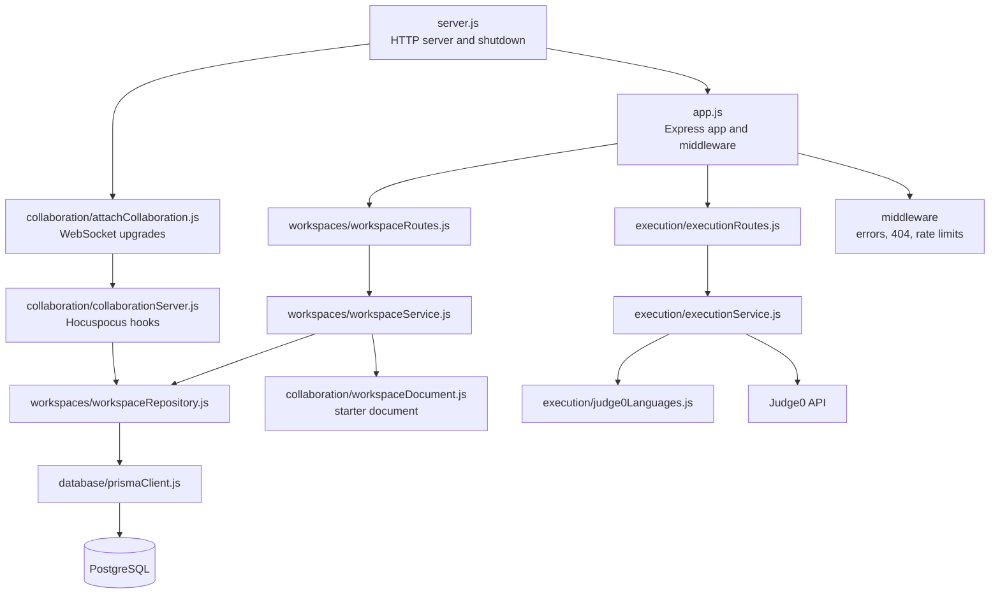

| Folder | Responsibility |
| --- | --- |
| `config/` | Reads environment variables once; decides which origins are allowed |
| `database/` | The single shared Prisma client |
| `errors/` | `HttpError`, an error that carries an HTTP status and a message safe to show users |
| `middleware/` | JSON error handler, JSON 404 handler and the rate limiter factory |
| `workspaces/` | Workspace IDs, creating and finding workspaces, all database access |
| `execution/` | Validating run requests, calling Judge0, mapping languages to Judge0 IDs |
| `collaboration/` | Hocuspocus hooks, WebSocket upgrades, helpers that build Yjs documents |

Routers are created by factory functions (`createWorkspaceRouter()`, `createExecutionRouter()`)
so each app instance gets its own rate limiter. Tests rely on this to start from a clean slate.

### 5.3 Persistence lifecycle

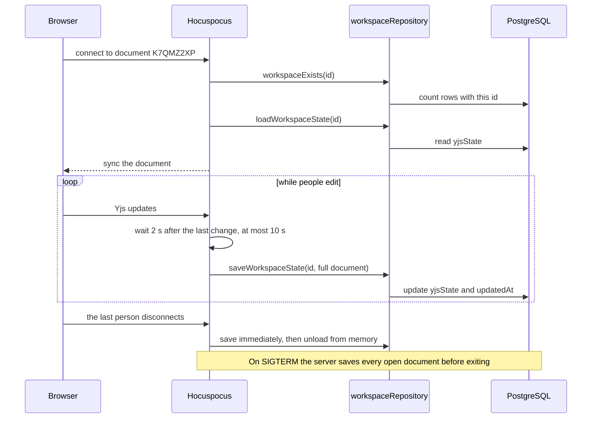

- **What is stored:** `Y.encodeStateAsUpdate(document)`, a compact binary snapshot of the
  whole document. A fresh workspace is about 350 bytes. There is no separate edit log to replay.
- **When it is stored:** two seconds after editing pauses, at least every ten seconds during
  continuous editing, immediately when the last person leaves, and on shutdown.
- **Graceful shutdown:** on `SIGTERM` (what Render sends on redeploy) or `SIGINT`, the server
  stops accepting connections, saves every open document with `Promise.allSettled` so one
  failure cannot block the rest, disconnects Prisma and exits with code 1 if any save failed.
- **Even if the server dies without saving,** every connected browser still holds the full
  document and sends whatever the server is missing when it reconnects.

### 5.4 REST and WebSocket API

All REST errors have the shape `{ "message": "…" }`.

| Method and path | Request | Success | Errors |
| --- | --- | --- | --- |
| `GET /health` | – | `200 { "status": "ok" }` | – |
| `POST /api/workspaces` | – | `201 { id, createdAt, updatedAt }` | `429` more than 20 per minute per IP, `503` no free ID after 5 tries |
| `GET /api/workspaces/:id` | ID in any letter case | `200 { id, createdAt, updatedAt }` | `400` invalid characters, `404` not found |
| `GET /api/execute/languages` | – | `200 { "languages": ["c", "cpp", …] }` | – |
| `POST /api/execute` | `{ "language": "python", "sourceCode": "print(1)" }` | `200 { status, stdout, stderr, compileOutput, message, time, memory }` | `400`, `413`, `429`, `502`, `503`, `504` (see 5.5) |
| WebSocket `/collaboration` | Hocuspocus protocol; document name = workspace ID | Live sync and awareness | Refused with `workspace-not-found`; upgrade rejected with `403` or `404` |

**Workspace IDs** are 8 characters drawn with `crypto.randomInt` from a 32-character
alphabet that leaves out the look-alikes `0`, `O`, `1` and `I`. That gives 32⁸ ≈ 1.1 trillion
possible IDs. If an ID is already taken, creation retries with a new one up to five times.
IDs are accepted in any case and normalized to upper case. Older 6-character IDs are still
accepted.

### 5.5 Running code with Judge0

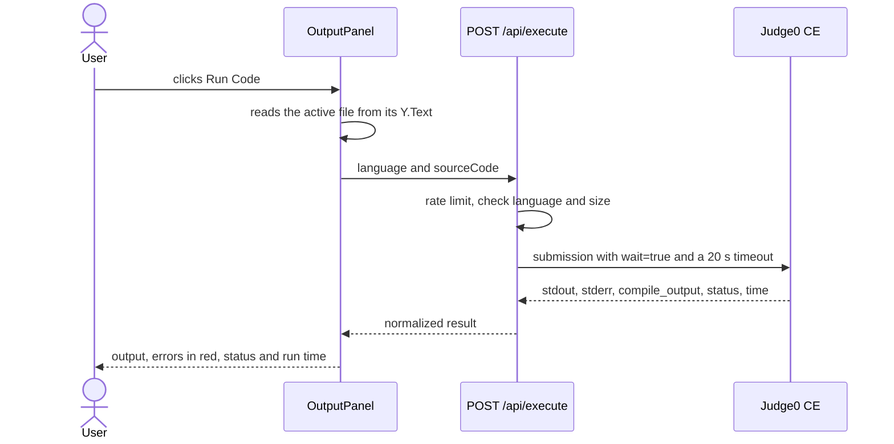

| Language | Extensions | Judge0 ID |
| --- | --- | --- |
| C | `.c` | 50 |
| C++ | `.cpp` `.cc` `.cxx` `.hpp` `.h` | 54 |
| C# | `.cs` | 51 |
| Go | `.go` | 60 |
| Java | `.java` | 62 |
| JavaScript | `.js` `.jsx` `.mjs` `.cjs` | 63 |
| PHP | `.php` | 68 |
| Python | `.py` | 71 |
| Ruby | `.rb` | 72 |
| Rust | `.rs` | 73 |
| TypeScript | `.ts` `.tsx` | 74 |

HTML, CSS, JSON, Markdown, SQL and files without a known extension get syntax highlighting
only; the Run button is disabled for them.

| Status | Meaning |
| --- | --- |
| `400` | Unsupported language or empty source code |
| `413` | Source code longer than 50,000 characters |
| `429` | More than 10 runs per minute from this IP, or the Judge0 quota is used up |
| `502` | Judge0 is unreachable or returned an error |
| `503` | `RAPIDAPI_KEY` is not set on the server |
| `504` | Judge0 did not answer within 20 seconds |

Notes: only the active file is run; there is no standard input; the output is shown only to
the person who clicked Run; and the API key never leaves the server. Language lookup uses
`Object.hasOwn`, so names such as `constructor` cannot slip through as a language.

### 5.6 Limits, errors and security

| Concern | How it is handled |
| --- | --- |
| Unknown workspaces | REST returns `404`; WebSocket connections are refused in `onConnect` |
| Guessing workspace IDs | 32⁸ possible IDs from a cryptographic random source |
| Abuse of Run Code | 10 runs per minute per IP, 50,000-character limit, 20-second timeout |
| Workspace spam | 20 workspaces per minute per IP |
| Large payloads | JSON bodies up to 100 KB; WebSocket messages up to 5 MB |
| Cross-site WebSocket use | `Origin` checked against `CLIENT_ORIGIN` |
| Real client IPs behind Render's proxy | `trust proxy` is set to 1 hop so rate limits count the user's IP |
| Leaking internals | Unexpected errors return "Internal server error" and are logged on the server |
| Bad JSON bodies | Answered with `400` instead of crashing a route |
| Malformed presence data | Every remote field is validated before use |
| Secrets | The Judge0 key exists only in the backend's environment |

**What is deliberately not protected:** there are no accounts. Anyone with a workspace link
can read, edit, rename and delete everything in that workspace. The link is the key.

---

## 6. The frontend

### 6.1 Pages and components

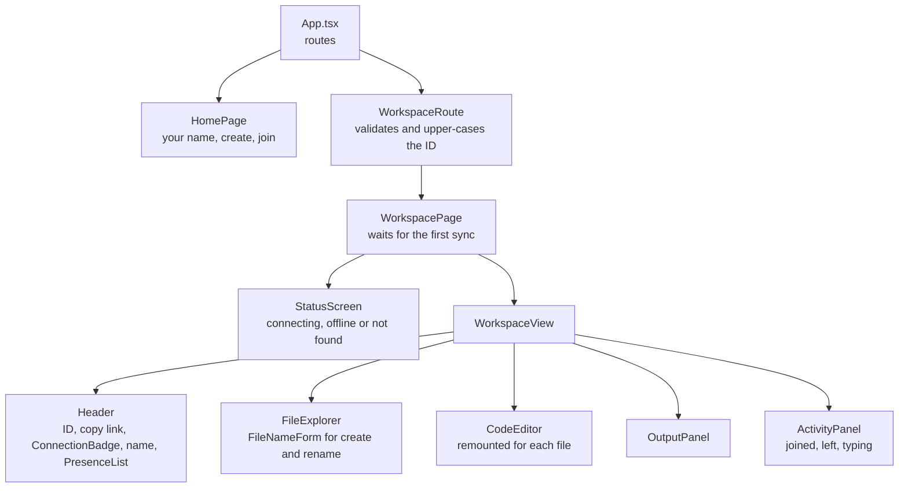

| Component | Responsibility |
| --- | --- |
| `HomePage` | Edit your display name, create a workspace, continue the last one, or join by ID (checked with `GET /api/workspaces/:id` before navigating) |
| `WorkspaceRoute` | Rejects invalid IDs and redirects `/workspace/ab12cd34` to `/workspace/AB12CD34` |
| `WorkspacePage` | Connection gate: shows a status screen until the document has synced once |
| `WorkspaceView` | The workspace layout; owns the selected file and turns UI actions into document operations |
| `FileExplorer` / `FileNameForm` | File list with inline create and rename, validation messages and a delete confirmation |
| `CodeEditor` | Mounts Monaco and attaches the collaborative binding; keyed by file ID so every file gets a fresh editor |
| `OutputPanel` | Runs the active file and shows output, errors, status and time |
| `PresenceList`, `ActivityPanel`, `ConnectionBadge`, `StatusScreen` | Presentation of presence, activity, connection state and full-page messages |

### 6.2 Hooks: connecting React to Yjs

Yjs objects are mutable stores that live outside React. The hooks subscribe to them through
`useSyncExternalStore`, React's built-in API for external stores, instead of copying data
into component state by hand.

| Hook | Returns | How it works |
| --- | --- | --- |
| `useWorkspaceConnection(id)` | `session`, `status`, `error` | Creates the provider in an effect; sets `session` only after the first sync; destroys the provider on unmount, which also makes React StrictMode's double mount safe |
| `useWorkspaceFiles(doc)` | sorted `WorkspaceFile[]` | Deep-observes the `files` map but ignores events that are pure text edits, so typing does not re-render the file list |
| `usePresence(awareness)` | `peers`, `activity` | Rebuilds the peer list on awareness changes and keeps the last 20 joined and left events; the panel shows 8 |
| `useDisplayName()` | `[name, setName]` | Stored in `localStorage`; a first-time visitor gets a name like `Guest-4821`; limited to 24 characters |

What stays in `localStorage` on each device:

| Key | Value |
| --- | --- |
| `username` | Your display name |
| `last-workspace` | The last workspace you opened, offered on the home page |
| `active-file-<workspaceId>` | The file you last had open in that workspace |

Storage access is wrapped in `try/catch`, so private browsing modes that block storage do not
break the app. File IDs come from `crypto.randomUUID()`, with a fallback for plain-HTTP pages
(such as testing from a phone on your local network) where that function is unavailable.

### 6.3 The Monaco ↔ Yjs binding

When an editor mounts, [`attachCollaborativeEditor`](frontend/src/collaboration/attachCollaborativeEditor.ts)
wires five pieces together and returns one function that undoes all of them:

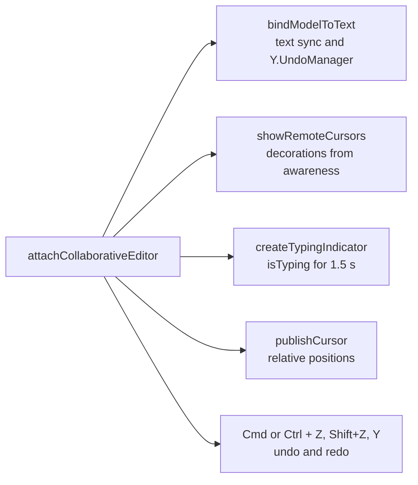

How [`textBinding.ts`](frontend/src/collaboration/textBinding.ts) translates between the two
models:

| Direction | Steps |
| --- | --- |
| Monaco → Yjs | One Monaco event can contain several changes (multi-cursor typing, find-and-replace). They are applied in **descending offset order** inside one Yjs transaction, so earlier changes do not shift the positions of later ones. |
| Yjs → Monaco | The Yjs delta (`retain`, `insert`, `delete`) is converted to offset edits, and touching edits are merged. All positions are computed **before** anything is applied, then everything goes into a **single** `applyEdits` call, so Monaco sees one atomic change. |

Delta conversion example:

| Yjs delta | Monaco edits |
| --- | --- |
| `[{ retain: 2 }, { delete: 3 }, { insert: "xy" }]` | Replace offsets 2–5 with `"xy"` |
| `[{ insert: "a" }, { retain: 4 }, { delete: 1 }]` | Insert `"a"` at 0, and delete offsets 4–5 |

The binding talks to Monaco through a small `BindableTextModel` interface rather than
Monaco's full type. That lets the tests drive it with a lightweight fake model.

---

## 7. Data model

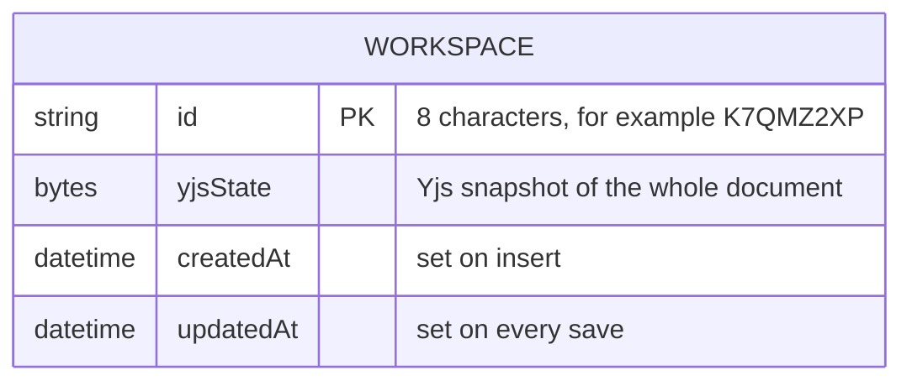

Postgres holds one row per workspace and nothing else. File names, contents and order all
live inside `yjsState`. There is no `File` table, because a second copy of the file list would
be a second source of truth that could disagree with the document.

**Upgrading from the old format.** Earlier versions kept file names in a `File` table and file
contents as top-level texts inside `yjsState`.
[`scripts/migrateLegacyWorkspaces.js`](backend/scripts/migrateLegacyWorkspaces.js) rebuilds
each old workspace in the new format and keeps every file's content. It uses raw SQL so it can
run before the schema changes, skips workspaces that are already converted, and is safe to run
twice. The full procedure is in [DEPLOYMENT.md](DEPLOYMENT.md).

---

## 8. What happens when…

| Situation | Result |
| --- | --- |
| Two people type on the same line at the same moment | Both edits are kept. Yjs orders simultaneous inserts the same way on every client, so everyone ends up with identical text. |
| Two people rename the same file at the same moment | The `name` field takes the last write. Every client agrees on the result. |
| Someone deletes a file another person is typing in | The delete wins. The typist's editor switches to the first remaining file, and edits in flight to the deleted file are dropped. |
| Two people create files with the same name at the same moment | Both files exist. Name uniqueness is checked locally before creating, and a CRDT cannot enforce global uniqueness. Rename one of them. |
| Someone keeps typing while offline | The edits stay in their local document and merge when they reconnect. |
| The server restarts during a session | It saves open documents on the way down. Clients show **Offline**, keep working, then reconnect and resync on their own. |
| You press undo after a teammate edited the same file | Only your own changes are reverted. |
| You open a link with lower-case letters | You are redirected to the upper-case ID and the workspace opens normally. |
| You open a link to a workspace that does not exist | The server refuses the connection and the page says the workspace does not exist. |

---

## 9. Design decisions and trade-offs

| Decision | Alternative considered | Why this one |
| --- | --- | --- |
| CRDT (Yjs) | Operational transformation, or locking a file to one editor | Merges concurrent and offline edits without a central ordering step; a mature library instead of hand-written merge logic |
| File tree inside the Y.Doc | A `File` table plus Socket.IO events | One source of truth; creates, renames and deletes get the same sync, persistence and reconnect behaviour as text. The old two-channel design lost file events after reconnects and leaked events between workspaces |
| Nested `Y.Map` per file | A top-level `Y.Text` per file | Nested types can be deleted, so deleted files really disappear |
| Awareness for presence | A separate presence service | Built into the Yjs protocol and cleaned up automatically when clients leave |
| Relative cursor positions | Line and column numbers | Cursors stay on the right character while others edit above them |
| `Y.UndoManager` with a local origin | Monaco's own undo | Monaco's undo replays at stale offsets after remote edits |
| Whole-document snapshot in one `bytea` column | Storing every update as a row | Simple to load and save; documents of this size are small |
| Single port | Separate ports for REST and WebSocket | Free hosting exposes only one port |
| Single backend instance | Several instances with Redis | Simple to run and explain. Scaling out would need the Hocuspocus Redis extension and sticky sessions |
| Hand-written Monaco binding | The `y-monaco` package | About 150 lines that are fully tested and explainable, with origin-based echo suppression, single-call remote edits and undo tracking; `y-monaco` is a valid alternative |

---

## 10. Project structure

```
.
├── backend
│   ├── prisma/schema.prisma            Workspace table
│   ├── scripts/
│   │   └── migrateLegacyWorkspaces.js  One-off upgrade from the old File-table format
│   ├── src
│   │   ├── server.js                   HTTP server, WebSocket wiring, graceful shutdown
│   │   ├── app.js                      Express app: CORS, JSON body, routes, error handling
│   │   ├── config/
│   │   │   ├── env.js                  Reads PORT, CLIENT_ORIGIN and RAPIDAPI_KEY
│   │   │   └── cors.js                 Allowed origins for REST and WebSocket
│   │   ├── database/prismaClient.js    Shared Prisma client
│   │   ├── errors/HttpError.js         Error with an HTTP status
│   │   ├── middleware/
│   │   │   ├── errorHandler.js         Turns errors into JSON responses
│   │   │   ├── notFoundHandler.js      JSON 404 for unknown routes
│   │   │   └── rateLimiter.js          Per-IP, per-minute limiter factory
│   │   ├── workspaces/
│   │   │   ├── workspaceRoutes.js      POST and GET /api/workspaces
│   │   │   ├── workspaceService.js     Create with ID retry, look up with validation
│   │   │   ├── workspaceRepository.js  All Prisma queries
│   │   │   └── workspaceId.js          Generate, normalize and validate IDs
│   │   ├── execution/
│   │   │   ├── executionRoutes.js      POST /api/execute and GET /api/execute/languages
│   │   │   ├── executionService.js     Validation, Judge0 call, result mapping
│   │   │   └── judge0Languages.js      Language name to Judge0 ID
│   │   └── collaboration/
│   │       ├── collaborationServer.js  Hocuspocus hooks and saving open documents
│   │       ├── attachCollaboration.js  Path and origin checks for WebSocket upgrades
│   │       └── workspaceDocument.js    Builds the starter document
│   └── tests/                          Vitest and Supertest suites, in-memory repository
├── frontend
│   └── src
│       ├── main.tsx, App.tsx           Entry point and routes
│       ├── api/                        fetch wrapper, workspace and execution calls
│       ├── collaboration/
│       │   ├── workspaceDocument.ts    Create, rename, delete, list and validate files
│       │   ├── createWorkspaceProvider.ts  Hocuspocus provider and status mapping
│       │   ├── textBinding.ts          Monaco ⇄ Y.Text sync and undo
│       │   ├── remoteCursors.ts        Draws other people's carets and selections
│       │   ├── attachCollaborativeEditor.ts  Wires the editor pieces together
│       │   ├── typingIndicator.ts      isTyping with a 1.5 s timeout
│       │   └── presence.ts             Validates and reads awareness states
│       ├── hooks/                      Connection, files, presence and display name
│       ├── components/                 Editor, file explorer, output, presence, activity
│       ├── pages/                      Home, workspace route and workspace page
│       ├── styles/                     Global theme and the 8 user colours
│       ├── utils/                      Languages, colours, storage, IDs
│       └── __tests__/                  Document, binding, presence and utility tests
├── .github/workflows/ci.yml            Lint, test and build on every push and pull request
├── docker-compose.yml                  Local PostgreSQL
└── DEPLOYMENT.md                       Render, Vercel and Supabase guide
```

---

## 11. Running locally

**Prerequisites:** Node 22 or newer, and PostgreSQL. Docker is the quickest way to get Postgres:

```bash
docker compose up -d
```

**Backend** (http://localhost:3000)

```bash
cd backend
cp .env.example .env
npm install
npm run db:push
npm run dev
```

| Variable | Required | Purpose |
| --- | --- | --- |
| `DATABASE_URL` | Yes | Postgres connection string; the example matches `docker-compose.yml` |
| `CLIENT_ORIGIN` | No | Comma-separated frontend origins allowed for REST and WebSocket. Empty allows all, which is fine locally |
| `RAPIDAPI_KEY` | No | Judge0 CE key from RapidAPI. Without it, Run Code says execution is not configured |
| `PORT` | No | Defaults to 3000; hosts like Render set it automatically |

**Frontend** (http://localhost:5173)

```bash
cd frontend
cp .env.example .env
npm install
npm run dev
```

| Variable | Purpose |
| --- | --- |
| `VITE_API_URL` | Backend URL. The WebSocket URL is derived from it: `http` becomes `ws`, `https` becomes `wss`, plus `/collaboration` |

Open the same workspace in two browser windows to see collaboration in action.

**Scripts**

| Package | Script | What it does |
| --- | --- | --- |
| backend | `npm run dev` | Starts the server and restarts on file changes (`node --watch`) |
| backend | `npm start` | Starts the server for production |
| backend | `npm run db:push` | Applies `schema.prisma` to the database |
| backend | `npm run db:migrate-legacy` | Converts workspaces from the old format |
| backend | `npm test` / `npm run lint` | Tests and lint |
| frontend | `npm run dev` | Vite dev server |
| frontend | `npm run build` | Type-checks and builds to `dist/` |
| frontend | `npm test` / `npm run lint` | Tests and lint |

---

## 12. Testing

```bash
cd backend && npm run lint && npm test
cd frontend && npm run lint && npm test && npm run build
```

| Test file | What it proves |
| --- | --- |
| `backend/tests/collaboration.test.js` | Starts a real WebSocket server and connects real Hocuspocus clients: two clients sync file creation, concurrent edits and deletes; open documents are saved; unknown workspaces and wrong paths are refused |
| `backend/tests/workspaceRoutes.test.js` | Creating a seeded workspace, retrying on an ID collision, case-insensitive lookup, `400` and `404`, health check, JSON 404 and malformed JSON |
| `backend/tests/executionRoutes.test.js` | Judge0 result mapping, language and size validation, quota and gateway errors, a missing key, and the rate limit |
| `backend/tests/workspaceId.test.js` | ID format, uniqueness, normalization and validation |
| `backend/tests/workspaceDocument.test.js` | The starter document and file structure |
| `frontend/src/__tests__/textBinding.test.ts` | Local and remote edits, no echo, one `applyEdits` per remote change, per-user undo and redo, and cleanup |
| `frontend/src/__tests__/workspaceDocument.test.ts` | Create, rename and delete; deleted files leave nothing at the root; concurrent edits converge; file name rules |
| `frontend/src/__tests__/presence.test.ts` | Validation of untrusted awareness state |
| `frontend/src/__tests__/utils.test.ts` | Language mapping, runnable languages, colours and workspace IDs |

The backend tests replace the Prisma repository with an in-memory version
([memoryWorkspaceRepository.js](backend/tests/support/memoryWorkspaceRepository.js)), so they
need no database. GitHub Actions runs every check on each push to `main` and on every pull request.

---

## 13. Deployment

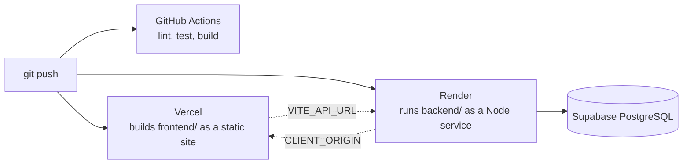

The step-by-step guide, including how to upgrade a database created by an older version, is
in [DEPLOYMENT.md](DEPLOYMENT.md).

---

## 14. Known limitations and future work

| Limitation | Possible next step |
| --- | --- |
| No accounts; the link is the only access control | Optional room passwords or sign-in with read-only links |
| One backend instance keeps open documents in memory | Hocuspocus Redis extension and sticky sessions |
| Run Code runs one file, has no input, and only the person who ran it sees the output | Multi-file projects, a stdin box, and a shared output panel kept in awareness or the document |
| File names are unique only when checked locally | Show a warning when a duplicate appears after a merge |
| No folders | Store a `path` field per file and render a tree |
| Workspaces are never cleaned up | Delete workspaces that have not been updated for a set number of days |
| Monaco loads from a CDN | Bundle Monaco with Vite for fully offline use |
| Render's free tier sleeps after about 15 idle minutes | Wake the backend before demos or use a paid instance |

---

## 15. FAQ

**Why not just send every keystroke through Socket.IO?**
Plain message passing needs extra logic to order and merge simultaneous edits, and edits made
while disconnected are lost. A CRDT makes merging automatic and deterministic.

**Is the CRDT written from scratch?**
No. CodeRoom uses Yjs for the CRDT. The project-specific code is the document design, the
Monaco binding, presence, undo integration, persistence and the server around them.

**Why store the document as bytes instead of a table of files?**
The Yjs document is the source of truth. A table would be a second copy that has to be kept
in sync and could disagree after concurrent edits.

**What happens to my work if the server crashes?**
The server saves a few seconds after each pause in editing and immediately when the last
person leaves. Anything newer is still in every connected browser and is sent to the server
when it comes back.

**Can two people see each other's Run Code output?**
Not at the moment. Output is local to the person who clicked Run.

---

## 16. Glossary

| Term | Meaning |
| --- | --- |
| CRDT | Conflict-free replicated data type: a data structure that every client can edit independently and that always merges to the same result |
| Yjs | The CRDT library used for the shared document |
| `Y.Doc` | One Yjs document; in CodeRoom, one per workspace |
| `Y.Map` / `Y.Text` | Shared map and shared text types inside a `Y.Doc` |
| Update | A small binary message describing changes to a `Y.Doc` |
| State vector | A summary of which updates a client has seen, used to send only what is missing |
| Awareness | Yjs's channel for temporary per-client state such as names and cursors; never saved |
| Relative position | A position tied to a specific character instead of a numeric offset, so it survives other edits |
| Transaction origin | A tag attached to a set of Yjs changes; CodeRoom uses it to tell local edits from remote ones |
| Hocuspocus | The server (and client provider) that speaks the Yjs sync protocol and calls hooks to load and save documents |
| Judge0 | An open-source online code execution system, used here through RapidAPI |
